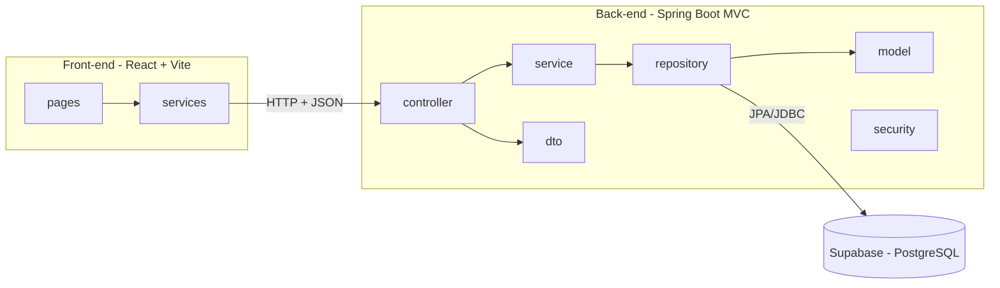

# 🚗 Sistema de Aluguel de Carros 👨‍💻

> [!NOTE]
> Sistema web para gestão de aluguéis de automóveis: clientes fazem, modificam, consultam e cancelam pedidos pela Internet, e agentes (empresas e bancos) avaliam os pedidos e executam os contratos.

Projeto do **Laboratório 02** da disciplina **Desenvolvimento e Integração de Aplicações Web (DIAW)**, do curso de Engenharia de Software da PUC Minas, sob orientação do Prof. Dr. João Paulo Carneiro Aramuni.

---

## 🚧 Status do Projeto

      

---

## 📚 Índice
- [Links Úteis](#-links-úteis)
- [Sobre o Projeto](#-sobre-o-projeto)
- [Funcionalidades Principais](#-funcionalidades-principais)
- [Tecnologias Utilizadas](#-tecnologias-utilizadas)
- [Arquitetura](#-arquitetura)
- [Instalação e Execução](#-instalação-e-execução)
- [Estrutura de Pastas](#-estrutura-de-pastas)
- [Demonstração](#-demonstração)
- [Testes](#-testes)
- [Documentações utilizadas](#-documentações-utilizadas)
- [Autores](#-autores)
- [Agradecimentos](#-agradecimentos)
- [Licença](#-licença)

---

## 🔗 Links Úteis
* 📖 **Documentação de modelagem:** pasta [`/docs`](./docs) (casos de uso, histórias do usuário, diagrama de classes e diagrama de pacotes).
* 🌐 **Demo Online:** não publicada (o projeto roda localmente, veja [Instalação e Execução](#-instalação-e-execução)).

---

## 📝 Sobre o Projeto

O sistema nasce de uma necessidade comum em locadoras: permitir que o cliente peça, altere e cancele um aluguel sem sair de casa, enquanto a empresa ou o banco analisa o pedido do ponto de vista financeiro antes de fechar o contrato.

- **Problema que resolve:** centraliza o ciclo de vida do pedido de aluguel (criação, análise, aprovação, contrato) em um único sistema web com controle de acesso.
- **Contexto:** projeto acadêmico (DIAW, PUC Minas), com foco em modelagem UML coerente com o código e arquitetura MVC.
- **Uso:** só acessa o sistema quem tem cadastro prévio e está autenticado. Clientes e agentes enxergam e podem fazer coisas diferentes.

Sobre os contratantes, o sistema guarda RG, CPF, nome, endereço, profissão e as entidades empregadoras com seus rendimentos (máximo 3). Os automóveis registram matrícula, ano, marca, modelo e placa, e podem ser propriedade de clientes, empresas ou bancos.

---

## ✨ Funcionalidades Principais

- 🔐 **Autenticação:** login obrigatório com usuário e senha (senha guardada com BCrypt) e cadastro de clientes.
- 👤 **CRUD de cliente:** cadastro com até 3 rendimentos, consulta e edição dos próprios dados, exclusão da conta.
- 📝 **Pedidos de aluguel (cliente):** criar, consultar o status, modificar (enquanto `EM_ANALISE`) e cancelar.
- ✅ **Análise de pedidos (agentes):** veem a renda total e os rendimentos do cliente, aprovam, reprovam e executam o contrato dos pedidos aprovados (o que gera um contrato com data de execução).
- ✏️ **Modificação de pedidos (agentes):** empresa ou banco podem alterar carro e período de pedidos em análise ou aprovados (um pedido aprovado volta pra análise).
- 🏦 **Crédito (banco):** o banco concede um contrato de crédito (valor, juros % a.m. e parcelas) associado a um aluguel com contrato executado.
- 🚘 **Automóveis:** listagem dos carros e cadastro por agentes, com propriedade de cliente, empresa ou banco.
- 🧑‍💼 **Consulta de clientes (agentes):** lista dos clientes cadastrados com seus rendimentos.

**Ciclo de vida de um pedido:**
`EM_ANALISE` → `APROVADO` → `CONTRATO_EXECUTADO`, ou `REPROVADO` / `CANCELADO`.

---

## 🛠 Tecnologias Utilizadas

### 💻 Front-end
* **Biblioteca:** React 19
* **Linguagem:** JavaScript (ES6+)
* **Roteamento:** React Router 7
* **Estilização:** CSS puro (com tema claro/escuro automático)
* **Gerenciamento de estado:** Context API (autenticação)
* **Build Tool:** Vite 8

### 🖥️ Back-end
* **Linguagem:** Java 25 (JDK 25)
* **Framework:** Spring Boot 4.0.0 (Spring MVC, Spring Security, Spring Data JPA, Bean Validation)
* **Build e dependências:** Apache Maven
* **Banco de Dados:** Supabase (PostgreSQL)
* **ORM:** Hibernate/JPA
* **Autenticação:** Spring Security (HTTP Basic, stateless) com senhas em BCrypt

---

## 🏗 Arquitetura

O back-end segue a arquitetura **MVC** em camadas, expondo uma API REST consumida pelo front-end React (que faz o papel da **View**). O banco é o PostgreSQL hospedado no Supabase.

- **Controller:** recebe as requisições HTTP e devolve JSON.
- **Service:** regras de negócio (por exemplo, só é possível modificar um pedido em análise).
- **Repository:** acesso a dados com Spring Data JPA.
- **Model:** entidades JPA (`Usuario`, `Cliente`, `Agente`, `Empresa`, `Banco`, `Rendimento`, `Automovel`, `Pedido`, `Contrato`, `ContratoCredito`).
- **DTO:** objetos de entrada e saída da API, com validação.
- **Security:** autenticação, perfis (`CLIENTE`, `EMPRESA`, `BANCO`) e regras de acesso por rota.
- **Config:** CORS, tratamento global de erros e dados iniciais (seed).



### Diagramas de modelagem

Os diagramas UML (PlantUML) estão em [`/docs`](./docs):

| Diagrama | Arquivo |
| :--- | :--- |
| Casos de Uso | [`docs/casos-de-uso.puml`](./docs/casos-de-uso.puml) |
| Histórias do Usuário | [`docs/historias-de-usuario.md`](./docs/historias-de-usuario.md) |
| Classes | [`docs/classes.puml`](./docs/classes.puml) |
| Pacotes (Visão Lógica) | [`docs/pacotes.puml`](./docs/pacotes.puml) |

As versões anteriores dos modelos ficam em [`docs/versoes`](./docs/versoes), com o resumo do que mudou.

### Endpoints principais

| Método | Rota | Quem acessa |
| :--- | :--- | :--- |
| POST | `/api/auth/register` | público (cadastro de cliente) |
| GET | `/api/auth/me` | autenticado |
| GET / PUT / DELETE | `/api/clientes/me` | cliente |
| GET | `/api/clientes` | empresa, banco |
| GET | `/api/automoveis` | autenticado |
| POST | `/api/pedidos` | cliente |
| GET | `/api/pedidos` | autenticado (cliente vê só os seus) |
| PUT | `/api/pedidos/{id}` | cliente (seus pedidos) ou agente |
| DELETE | `/api/pedidos/{id}` | cliente (cancelar) |
| PATCH | `/api/pedidos/{id}/avaliacao` | empresa, banco (aprovar, reprovar, executar contrato) |
| POST | `/api/pedidos/{id}/credito` | banco (conceder crédito) |
| POST | `/api/automoveis` | empresa, banco |

---

## 🔧 Instalação e Execução

### Pré-requisitos
* **Java JDK 25**
* **Apache Maven** 3.9 ou superior
* **Node.js** LTS (v20 ou superior) e npm
* Um projeto no **Supabase** (o banco PostgreSQL)

### 🔑 Variáveis de Ambiente

#### 1. Back-end (Spring Boot)

| Variável | Descrição | Exemplo |
| :--- | :--- | :--- |
| `DB_URL` | URL JDBC do Supabase (Session pooler) | `jdbc:postgresql://aws-0-sa-east-1.pooler.supabase.com:5432/postgres?sslmode=require` |
| `DB_USER` | Usuário do banco | `postgres.SEU_PROJECT_REF` |
| `DB_PASSWORD` | Senha do banco | `sua_senha_do_banco` |
| `CORS_ORIGIN` | URL do front-end liberada no CORS | `http://localhost:5173` |
| `SEED_ENABLED` | Cria dados de exemplo no primeiro start | `true` |

Há um modelo em [`backend/.env.example`](./backend/.env.example). **Nunca** versione senhas reais.

#### 2. Front-end (React, Vite)

Crie `frontend/.env.local` (modelo em [`frontend/.env.example`](./frontend/.env.example)):

| Variável | Descrição | Exemplo |
| :--- | :--- | :--- |
| `VITE_API_URL` | URL base do back-end | `http://localhost:8080` |

### 📦 Instalação de Dependências

```bash
git clone <URL_DO_SEU_REPOSITORIO>
cd aluguel-carros

# Front-end
cd frontend
npm install
cd ..
```

O Maven baixa as dependências do back-end automaticamente na primeira execução.

### 💾 Banco de Dados (Supabase)

1. Crie um projeto no [Supabase](https://supabase.com).
2. Em **Connect → Session pooler**, copie host, porta e usuário.
3. Use esses dados nas variáveis `DB_URL`, `DB_USER` e `DB_PASSWORD`.

As tabelas são criadas automaticamente pelo Hibernate (`ddl-auto=update`) na primeira execução. Com `SEED_ENABLED=true`, o sistema também cria dois agentes e três carros de exemplo.

### ⚡ Como Executar a Aplicação

#### Terminal 1: Back-end (Spring Boot)

```bash
cd backend
# defina as variáveis de ambiente (exemplo PowerShell)
$env:DB_URL="jdbc:postgresql://<host>:5432/postgres?sslmode=require"
$env:DB_USER="postgres.<project-ref>"
$env:DB_PASSWORD="<sua-senha>"
mvn spring-boot:run
```
🚀 *O back-end estará em **http://localhost:8080**.* No VS Code também é possível rodar com F5 usando um `.vscode/launch.json` com essas variáveis.

#### Terminal 2: Front-end (React, Vite)

```bash
cd frontend
npm run dev
```
🎨 *O front-end estará em **http://localhost:5173**.*

#### Usuários de exemplo (seed)

| Perfil | Usuário | Senha |
| :--- | :--- | :--- |
| Banco | `banco` | `banco123` |
| Empresa | `locadora` | `locadora123` |

Clientes são criados pela tela **Cadastre-se**.

---

## 📂 Estrutura de Pastas

```
.
├── README.md
├── .gitignore
├── /docs                     # 📚 Modelagem UML (casos de uso, classes, pacotes) e histórias do usuário
├── /backend                  # 📁 Spring Boot
│   ├── .env.example
│   ├── pom.xml
│   └── /src/main
│       ├── /java/com/puc/aluguel
│       │   ├── /controller   # 🎮 Endpoints REST
│       │   ├── /service      # ⚙️ Regras de negócio
│       │   ├── /repository   # 🗄️ Spring Data JPA
│       │   ├── /model        # 🧬 Entidades
│       │   ├── /dto          # ✉️ Objetos de entrada/saída
│       │   ├── /security     # 🛡️ Autenticação e autorização
│       │   └── /config       # 🔧 CORS, erros globais, seed
│       └── /resources        # application.properties
└── /frontend                 # 📁 React + Vite
    ├── .env.example
    └── /src
        ├── /pages            # 📄 Login, Cadastro, Pedidos, Carros, Perfil, Clientes
        ├── /components       # 🧱 Layout e componentes reutilizáveis
        ├── api.js            # 🔌 Cliente HTTP
        └── AuthContext.jsx   # 🔐 Estado de autenticação
```

---

## 🎥 Demonstração

> Adicione aqui os prints das telas (salve em `docs/img/` e referencie com ``).

| Tela | Captura |
| :---: | :---: |
| **Login** | _print aqui_ |
| **Cadastro de cliente** | _print aqui_ |
| **Pedidos (cliente)** | _print aqui_ |
| **Avaliação de pedidos (agente)** | _print aqui_ |
| **Automóveis** | _print aqui_ |

#### Exemplo de chamada à API

```bash
curl -u banco:banco123 http://localhost:8080/api/auth/me
```

```json
{ "login": "banco", "perfil": "BANCO", "nome": "Banco Demo S.A." }
```

---

## 🧪 Testes

Testes automatizados ainda não foram implementados. Os fluxos principais são verificados manualmente com este roteiro:

1. Cadastrar um cliente (com rendimentos) e fazer login.
2. Criar um pedido de aluguel e conferir o status `Em análise`.
3. Modificar e cancelar um pedido.
4. Entrar como `locadora` (agente), conferir a renda do cliente, aprovar um pedido e executar o contrato.
5. Entrar como `banco` e conceder crédito ao aluguel com contrato executado.
6. Como agente, modificar um pedido em análise ou aprovado e cadastrar um automóvel.
7. Conferir que o cliente vê o status, o contrato e o crédito atualizados.

---

## 🔗 Documentações utilizadas

* 📖 [React](https://react.dev/)
* 📖 [Vite](https://vitejs.dev/)
* 📖 [Spring Boot](https://docs.spring.io/spring-boot/)
* 📖 [Spring Security](https://docs.spring.io/spring-security/reference/)
* 📖 [Supabase](https://supabase.com/docs)
* 📖 [Conventional Commits](https://www.conventionalcommits.org/en/v1.0.0/)

---

## 👥 Autores

| 👤 Nome | :octocat: GitHub | 💼 LinkedIn | 📤 Gmail |
|---------|-----------------|-------------|-----------|
| Gabriel Vinícius Soares Doti | [GabrielDoti](https://github.com/GabrielDoti) | [gabriel-doti](https://www.linkedin.com/in/gabriel-doti-33691b423) | [gabrieldoti69@gmail.com](mailto:gabrieldoti69@gmail.com) |

---

## 🙏 Agradecimentos

* [**Engenharia de Software PUC Minas**](https://www.instagram.com/engsoftwarepucminas/) pelo apoio institucional e estrutura acadêmica.
* [**Prof. Dr. João Paulo Aramuni**](https://github.com/joaopauloaramuni) pelos ensinamentos de Desenvolvimento e Integração de Aplicações Web.

---

## 📄 Licença

Projeto acadêmico distribuído sob a **Licença MIT**.
